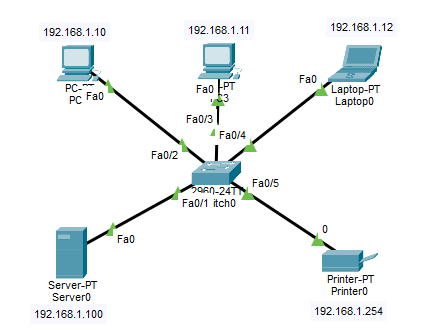

# Lab 1 Switch Fundamentals & L2 Operations (Switch Temelleri ve Katman 2 Operasyonları)

## 📋 Lab Özeti ve Amaç
Bu laboratuvar çalışmasında, bir switch (anahtarlama cihazı) etrafında çoklu uç cihazların (PC, Laptop, Sunucu ve Yazıcı) UTP kablolarla bağlanarak ortak bir Yerel Alan Ağı (LAN) oluşturması sağlanmıştır. Cihazlar aynı alt ağda (`192.168.1.X`) yapılandırılmış ve aralarındaki Katman 2 haberleşmesi `ping` testi ile doğrulanmıştır.

---

## 🖼️ Ağ Topolojisi

---

## 🛠️ Cihazlar ve IP Yapılandırma Tablosu

| Uç Cihaz | IP Adresi | Alt Ağ Maskesi (Subnet Mask) |
| :--- | :--- | :--- |
| **PC0** | `192.168.1.10` | `255.255.255.0` |
| **PC1** | `192.168.1.11` | `255.255.255.0` |
| **Laptop0** | `192.168.1.12` | `255.255.255.0` |
| **Server0** | `192.168.1.100` | `255.255.255.0` |
| **Printer0** | `192.168.1.254` | `255.255.255.0` |

---

## 🧪 Doğrulama ve Test Adımları
1. Tüm cihazlar Cisco 2960 Switch'e FastEthernet arayüzleri üzerinden UTP kablo ile bağlanmıştır.
2. PC0 üzerinden komut istemcisi (`Command Prompt`) açılmış ve diğer tüm cihazlara sırasıyla `ping` atılmıştır:
   * `ping 192.168.1.11` (PC1)
   * `ping 192.168.1.12` (Laptop0)
   * `ping 192.168.1.100` (Server0)
   * `ping 192.168.1.254` (Printer0)
3. Testler sonucunda `%0` paket kaybı (`Lost = 0`) ile başarılı geri dönüşler alınmıştır.

---
* **Simülasyon Dosyası:** [network_lab1.pkt](network_lab1.pkt)
