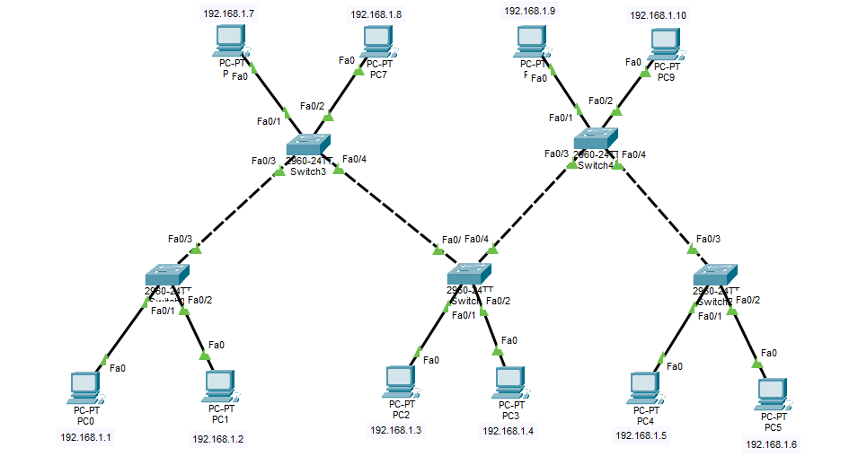

# Lab 2: Çoklu Switch ile Ağ Genişletme (Multi-Switch LAN Extension)

## 📋 Lab Özeti
Bu laboratuvar çalışmasında, tek bir switch sınırları aşılarak birden fazla anahtarlama cihazı birbirine bağlanmış ve yerel ağ (LAN) kapasitesi genişletilmiştir. Yıldız topolojisinden genişletilmiş ağ yapılarına geçiş simüle edilmiştir.

---

## 🖼️ Ağ Topolojisi

---

## 🛠️ Çalışma Detayları
* **Cihazlar:** Birden fazla Cisco 2960 Switch ve uç birimler (PC'ler).
* **IP Yapılandırması:** Tüm bilgisayarlar aynı alt ağda (`192.168.1.X` bloğu) yapılandırılmıştır.
* **Bağlantı:** Switch'ler birbirine çapraz (crossover) kablolarla bağlanarak ağ omurgası oluşturulmuştur.

---

## 🧪 Test Adımları
1. Farklı switch'lere bağlı olan bilgisayarlar arasında komut istemcisi (`Command Prompt`) açılmıştır.
2. `ping` komutu ile cihazlar arası haberleşme test edilmiştir.
3. Test sonucunda `%0` paket kaybı ile tüm cihazların sorunsuz haberleştiği görülmüştür.

---
* **Simülasyon Dosyası:** [network_lab2.pkt](network_lab2.pkt)
